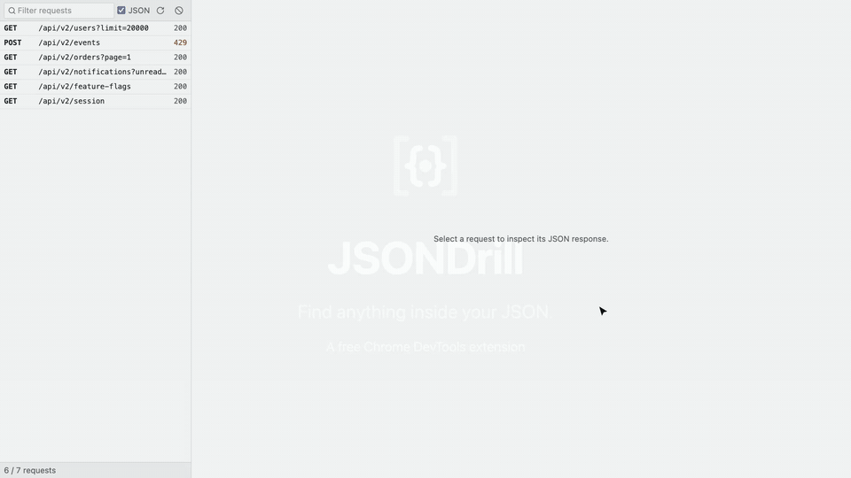

# JSONDrill

[](https://chromewebstore.google.com/detail/jsondrill/injlohhmedliakccmmpbipbnjjmonkip)
[](https://github.com/eaabak/jsondrill/actions/workflows/ci.yml)
[](LICENSE)

Smart JSON filtering directly inside Chrome DevTools.
**Find anything inside your JSON.**

JSONDrill adds a DevTools panel that lists the JSON responses captured by the Network panel,
detects their structure and lets you search any field or filter records like a spreadsheet,
without browsing thousands of nested objects or writing JSONPath.



## Features

- Request list with method, path and status, newest first, with text and JSON-only filters
- Automatic collection discovery (`data.items`, root arrays, nested wrappers) with a picker
- Schema detection from a bounded sample: types, nullable fields, missing properties, nested
  objects and arrays
- **Search**: across all fields or one selected field (identifier fields listed first), with
  Contains or Exact matching; large integer IDs stay exact
- Visual filter builder (`Field | Operator | Value`) combined with AND, supporting nested fields
  (`profile.city`) and array fields (`orders[].status`, matches when any element matches)
- Virtualized table view and lazily expanded JSON tree for large responses
- Copy or download the matching records as JSON
- Light and dark themes following the DevTools setting

## Install

Install JSONDrill from the [Chrome Web Store](https://chromewebstore.google.com/detail/jsondrill/injlohhmedliakccmmpbipbnjjmonkip), then open
DevTools on any page and select the **JSONDrill** panel.

JSONDrill only sees requests that DevTools has recorded. If the list is empty, keep DevTools open
and reload the page (the panel has a reload button).

## Build from source

Requires Node.js 22.12+ and Chrome 120+.

```bash
git clone https://github.com/eaabak/jsondrill.git
cd jsondrill
npm install
npm run build
```

1. Open `chrome://extensions` and enable **Developer mode**.
2. Click **Load unpacked** and select the `dist/` folder.
3. Open DevTools on any page and select the **JSONDrill** panel.

## Search and filter semantics

- Search with **Any field** looks at every value in a record, including nested objects and arrays.
  Choosing a field limits it to that field. **Contains** is case-insensitive; **Exact** compares
  strings exactly and numbers by value.
- Every condition tests the values found at the field path; conditions are combined with AND.
- For paths through arrays (`orders[].status`) a record matches when **any** element matches.
- `null`, `""` and a missing property are distinct: missing fields only match **Is missing**,
  `null` only matches **Is null** (and **Not equals**), `""` matches **Is empty**.
- **Equals** compares strings exactly and numbers by value, so `101` matches `101` and `"101"`.
- **Contains** and **Starts with** are case-insensitive. Numeric operators only match numbers.
- Conditions without a value, or with an invalid number, are ignored and highlighted.
- Integers beyond 2^53 are kept exact (as `bigint`) during parsing, comparison and export.

## Limits

- Responses larger than 32 MB are not parsed.
- Up to 500 requests are kept in memory; the list is cleared on navigation.
- Schema detection samples up to 1,000 records spread across the collection.
- The table shows up to 40 columns from fields up to three levels deep; use the JSON view or
  filters for deeper data.

## Privacy

JSONDrill runs entirely locally. It requests no extension permissions, makes no network
requests, collects no analytics and stores nothing on disk. Response bodies are read on demand
through the DevTools API and kept in memory only while a request is selected. See the full
[privacy policy](PRIVACY.md).

## Development

```bash
npm run dev        # rebuild dist/ on change, then reload the extension
npm run format     # format with Prettier
npm run lint       # lint with Oxlint
npm run typecheck
npm test
npm run check      # everything CI runs: format, lint, typecheck, tests and build
npm run package    # build and create jsondrill-<version>.zip for the Chrome Web Store
```

```
src/
  core/      JSON parsing, paths, collection discovery, schema inference, filtering (no browser APIs)
  network/   captured request model and the chrome.devtools adapter
  panel/     React UI: components, hooks and export helpers
  devtools.ts registers the panel
tests/       Vitest suites for core and network logic
```

See [CONTRIBUTING.md](CONTRIBUTING.md) for guidelines, [CHANGELOG.md](CHANGELOG.md) for release
notes and [SECURITY.md](SECURITY.md) for reporting vulnerabilities. This project follows a
[code of conduct](CODE_OF_CONDUCT.md).

## License

[MIT](LICENSE) © [Erkin](https://github.com/eaabak)
